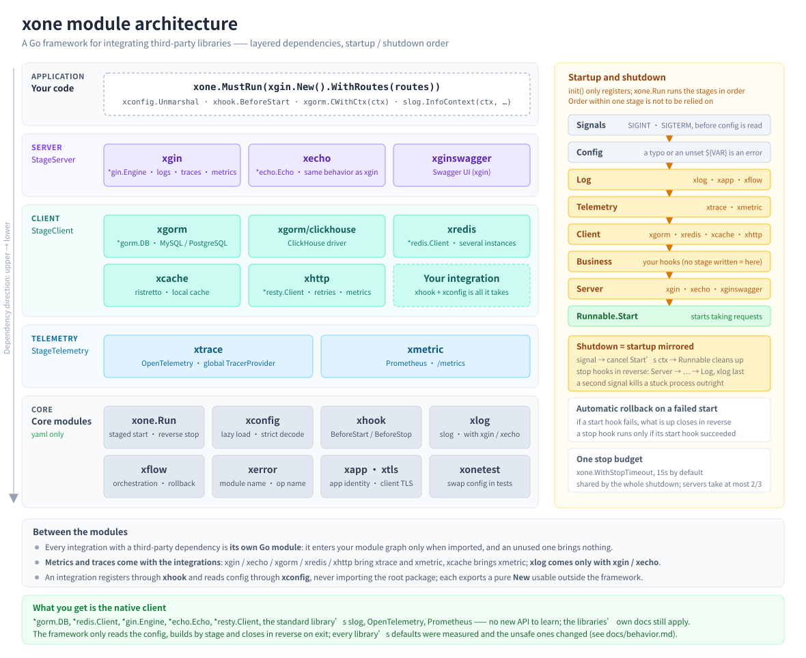

# xone

A ready-to-use framework for integrating third-party Go libraries.

Write one YAML file, call `xone.Run` once: the framework reads the configuration, builds each
component in order, and closes them in reverse order when a shutdown signal arrives.
What the caller gets is the **native client** -- `*gorm.DB`, `*redis.Client`, `*gin.Engine`, the
standard library's `slog` -- with no new API to learn.



## Features

- **No wiring boilerplate** -- import the integrations to be used, and initialization, shutdown and
  the order of both are the framework's business
- **Configuration driven, failing on a mistake** -- defaults are pre-filled; a misspelled field, an
  unset `${VAR}` or an invalid value is reported at startup with the file and the line number
- **Logging / tracing / metrics strung together** -- logs carry `trace_id`, outbound requests, SQL
  and Redis commands join the same trace, and connection pools bring their own metrics
- **Measured defaults** -- the default behavior of every library integrated has been measured and
  the unsafe ones changed (gin trusting every proxy by default, for one), see
  [behavior.md](docs/behavior.md)
- **Pay for what is used** -- every integration with a third-party dependency is its own Go module,
  and the ones left out never enter the module graph

## Getting started

**1. Install** (the core needs Go 1.23+, the integrations Go 1.25+; all modules share one version
number, so write the same one)

```bash
go get github.com/jupiter-eng/xone@v1.0.3 github.com/jupiter-eng/xone/xgin@v1.0.3
```

Upgrading likewise lists every xone module in use with the same version number. Upgrading the core
alone leaves xgin on the old version through Go's MVS; upgrading one integration alone pulls the
core it depends on (along with xmetric and xtrace) up with it -- either way the module versions no
longer match. Do not use `go get -u ./...`, which upgrades every indirect dependency as well.

**2. Write the configuration** in `conf/application.yml` (only what is to be changed, the rest takes
the defaults)

```yaml
XApp:
  Name: hello-api
XGin:
  Port: 8080
```

**3. Start it**

```go
package main

import (
	"log/slog"
	"net/http"

	"github.com/gin-gonic/gin"

	"github.com/jupiter-eng/xone"
	"github.com/jupiter-eng/xone/xgin"
)

func main() {
	xone.MustRun(xgin.New().WithRoutes(func(e *gin.Engine) {
		e.GET("/hello", func(c *gin.Context) {
			slog.InfoContext(c.Request.Context(), "hello called") // configured by XLog already, with trace_id
			c.JSON(http.StatusOK, gin.H{"msg": "hello"})
		})
	}))
}
```

```bash
go run .                      # conf/application.yml is found by itself
curl localhost:8080/hello     # {"msg":"hello"}; the access log, the trace and /metrics are already in place
# Ctrl+C shuts down gracefully: the requests in flight finish and the components close in reverse
# order; pressing it again while it is stuck terminates immediately
```

Fuller runnable examples are in [`example/`](example/): a web service, a message queue consumer, and
an integration of your own.

## Modules

| Module | Underlying library | What it gives |
|---|---|---|
| [xgin](xgin/README.md) | [gin](https://github.com/gin-gonic/gin) | A web service, with the access log, tracing, metrics and panic recovery built in |
| [xginswagger](xginswagger/README.md) | [gin-swagger](https://github.com/swaggo/gin-swagger) | Swagger UI |
| [xecho](xecho/README.md) | [Echo](https://github.com/labstack/echo) v4 | A web service with the same access log, tracing, metrics and panic recovery as xgin, on Echo |
| [xgorm](xgorm/README.md) | [gorm](https://gorm.io/) | `*gorm.DB`, with MySQL / PostgreSQL built in, and several data sources |
| [xgorm/clickhouse](xgorm/clickhouse/README.md) | [the gorm ClickHouse driver](https://github.com/go-gorm/clickhouse) | ClickHouse for xgorm |
| [xredis](xredis/README.md) | [go-redis](https://github.com/redis/go-redis) | `*redis.Client`, with several instances |
| [xcache](xcache/README.md) | [ristretto](https://github.com/dgraph-io/ristretto) | A local cache, read back by type |
| [xhttp](xhttp/README.md) | [resty](https://github.com/go-resty/resty) | Outbound HTTP, with retries, tracing and metrics |
| [xkafka](xkafka/README.md) | [franz-go](https://github.com/twmb/franz-go) | The native `*kgo.Client` for producing; `Consume` registers a consumer: in order within a partition, committed only once handled, with retries and a dead letter topic, and the handlers in flight finished on exit |
| [xcron](xcron/README.md) | [cronexpr](https://github.com/hashicorp/cronexpr) (for parsing only) | In-process scheduled jobs, each run carrying a trace and log fields, with the runs in flight finished on exit |
| [xtrace](xtrace/README.md) | [OpenTelemetry](https://github.com/open-telemetry/opentelemetry-go) | Tracing, installed as the global TracerProvider |
| [xmetric](xmetric/README.md) | [Prometheus](https://github.com/prometheus/client_golang) | Recording metrics, with `/metrics` mounted by xgin / xecho |
| [xlog](xlog/README.md) | [log/slog](https://pkg.go.dev/log/slog) (the standard library) | Structured logging, file rotation, per-request fields |
| [xconfig](xconfig/README.md) | — | Reading a configuration block of your own |
| [xflow](xflow/README.md) | — | Orchestrating a flow, rolling back automatically on a failure |
| [xapp](xapp/README.md) · [xtls](xtls/README.md) | — | The application name / version · client TLS (shared by XGorm / XRedis / XHttp / XKafka) |

`xconfig`, `xlog`, `xflow`, `xapp`, `xtls`, `xhook`, `xerror`, `xutil` and `xonetest` all live in the
core module, and the core depends on yaml alone. A few need no import of their own and come along
with something else:

| Module | Comes along with | When none of them is used |
|---|---|---|
| `xapp` (the `XApp` block) | `xone` itself | — |
| `xlog` | xgin, xecho, xcron | The framework does not take logging over and `slog.Default()` stays yours; to use it, import `github.com/jupiter-eng/xone/xlog` anonymously |
| `xtrace`, `xmetric` | xgin, xecho, xgorm, xredis, xhttp, xkafka; xcache brings xmetric alone and xcron xtrace alone | Import it anonymously when it is wanted, see [Observability, "Tracing"](docs/observability.md#tracing) |

## Everyday usage

The full usage is in each module's README; only the most common things are listed here.

**Logging** -- the standard library's `slog`, where only the methods taking a ctx carry `trace_id`:

```go
slog.InfoContext(ctx, "order created", "order_id", id, "amount", amount)

xlog.AddKV(ctx, "user_id", uid)                             // every later log of this request carries it
ctx = xlog.CtxWithKV(ctx, map[string]any{"order_id": id})   // affects only the logs written with the new ctx
```

**Databases / Redis / the local cache**:

```go
var u User
err := xgorm.CWithCtx(ctx).First(&u, id).Error   // several data sources: xgorm.CWithCtx(ctx, "report")

v, err := xredis.C().Get(ctx, "k").Result()

xcache.Set("user:1", u)
cached, ok := xcache.Get[User]("user:1")
```

**Outbound HTTP** (the trace headers and the metrics come along by themselves):

```go
resp, err := xhttp.R(ctx).SetResult(&out).Get("https://api.example.com/users/1")
```

**Metrics**:

```go
xmetric.CounterInc("orders_created_total", xmetric.T("channel", "app"))
xmetric.ObserveDuration("payment_call", time.Since(start))
defer xmetric.TrackInFlight("jobs_in_flight")()
```

**Reading a configuration of your own**:

```go
var c struct {
	Timeout time.Duration `yaml:"Timeout"`
}
err := xconfig.Unmarshal("Order", &c)   // reads the Order block of application.yml, at any time
```

## Ways to start

```go
xone.MustRun(xgin.New().WithRoutes(routes))   // a web service
xone.MustRun(xone.UntilSignal())              // a long-running process: a consumer or scheduled jobs, with the components started in hooks
xone.MustRun(xone.Func(migrate))              // a one-off task: it exits when the function returns
xone.MustRun(myServer)                        // a server of your own: implementing Start(ctx) error is enough
```

To do something before startup or before shutdown (warming up, starting a consumer, flushing a
buffer), register a hook in `init()`:

```go
func init() {
	xhook.BeforeStart(func(ctx context.Context) error { return warmUp(ctx) }) // the database and Redis are ready by now
	xhook.BeforeStop(func(ctx context.Context) error { return flush(ctx) })   // runs only once the one above has succeeded
}
```

`init()` only registers; the framework runs them by stage, Log -> Telemetry -> Client -> Business ->
Server, and in reverse on exit. A business hook writes no stage. The details are in
[Hooks and stages](docs/guide.md#hooks-and-stages).

## The configuration file

- **Where it goes**: `conf/application.yml` (`config/`, the current directory and `.yaml` are
  recognized too); or `--config=<path>`, or the environment variable `XONE_CONFIG`.
- **Several environments**: `XApp.Profiles: ${APP_ENV:dev}` lays `application-dev.yml` on top, and
  `--profile=prod` overrides it.
- **Splitting files**: `XApp.Import: [common/log.yml]`.
- **Seeing what is in effect**: `XONE_DEBUG=1 ./app` prints which files were read and the whole
  merged configuration (with credentials masked).

The full loading order, the merge rules and an example with several environments are in
[config.md](docs/config.md).

## Documentation

| For | Read |
|---|---|
| From running it to running it in production: hooks, services that are not web servers, testing, deployment, writing an integration of your own | [The guide](docs/guide.md) |
| Where the configuration file goes, profiles, imports, placeholders, several environments | [Configuration](docs/config.md) |
| The summary table of defaults that differ from the underlying library | [Default behavior](docs/behavior.md) |
| The conventions for logging, metrics and tracing, and tracing's trust boundary | [Observability](docs/observability.md) |
| Troubleshooting by the error text | [Troubleshooting](docs/troubleshooting.md) |
| Why it looks the way it does | [Architecture and design](docs/architecture.md) |
| What changed in each version and how to migrate | [The changelog](docs/CHANGELOG.md) |
| Taking part in development | [Development](docs/development.md) |
