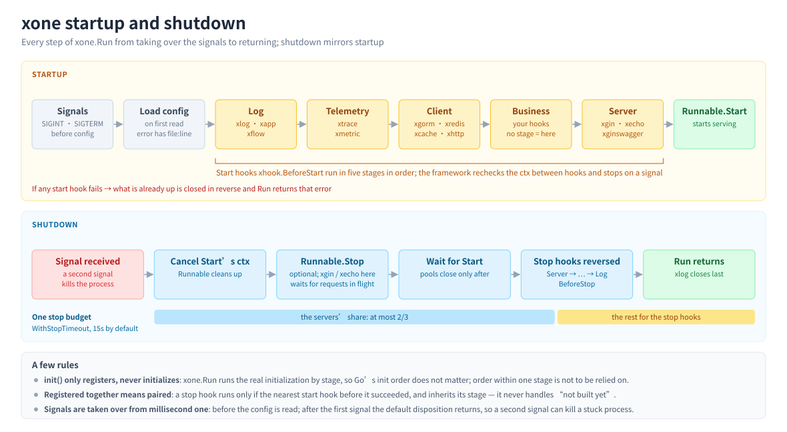

# Usage guide

What to know between "it runs" and "it is in production", in the order it comes up. How to use
each module, and all of its configuration fields, live in the README in its own directory (see
[Modules](../README.md#模块)); where config files go and how they layer is in
[`config.md`](config.md), errors are in [`troubleshooting.md`](troubleshooting.md), and why it is
designed this way is in [`architecture.md`](architecture.md).

| Term | Meaning |
|---|---|
| Module | A Go module. The core is `github.com/jupiter-eng/xone`, and every integration with third-party dependencies is one of its own (`…/xgorm`, `…/xgin`, ...) |
| Integration | A package that registered start / stop hooks through `xhook`: xlog, xgorm, xredis, ... You can write one too |
| Instance | One client an integration built from the configuration, taken by name: `xgorm.C()` is `default` and `xgorm.C("report")` is another |
| Stage | Which stage a hook runs in (`xhook.Stage`): log → telemetry → clients → business → server, and the reverse on shutdown |
| Stop budget | `xone.WithStopTimeout` (15s by default): the total time from the start of shutdown to `Run` returning, and the whole shutdown has that one budget |

- [The whole picture of startup and shutdown](#the-whole-picture-of-startup-and-shutdown)
- [Reading your own configuration](#reading-your-own-configuration)
- [Hooks and stages](#hooks-and-stages)
- [Stop hooks: pairing and inheritance](#stop-hooks-pairing-and-inheritance)
- [Runnable](#runnable)
- [Non-web services: consumer / job](#non-web-services-consumer--job)
- [Several instances](#several-instances)
- [Error handling](#error-handling)
- [Testing](#testing)
- [Deployment](#deployment)
- [Writing an integration of your own](#writing-an-integration-of-your-own)

## The whole picture of startup and shutdown



```
startup:  take over signals → load config → StageLog → StageTelemetry → StageClient → StageBusiness → StageServer → Runnable.Start
shutdown: cancel Start's ctx → Runnable.Stop (optional) → wait for Start to return → stop hooks in reverse (StageServer → … → StageLog)
```

`xone.Run` blocks until `Start` returns or a SIGINT / SIGTERM arrives, and then runs the shutdown.
When any start hook fails, the ones after it do not run, whatever is already up is closed in
reverse order, and `Run` returns that error; `MustRun` prints it to stderr and exits with 1.

## Reading your own configuration

The business's own config block follows the same rules as the framework's: defaults pre-filled in
the struct, a misspelled field failing startup, `${VAR}` working as usual, and `Validate()` running
during startup.

```go
c := Config{Topic: "orders", Workers: 4, Timeout: 5 * time.Second} // defaults pre-filled
if err := xconfig.Unmarshal("MyApp", &c); err != nil {
	log.Fatal(err)
}
xone.MustRun(&Consumer{workers: c.Workers, timeout: c.Timeout})
```

- **Read it any time before `Start`** (in `main`, before `xone.Run`, or in a `BeforeStart` hook):
  the config file is loaded the first time it is read, and what comes back is always the final
  values. **Do not read it only inside `Start`**: a top-level key still unread when every start
  hook has run fails startup (`config keys [...] are not read by anyone`).
- Struct fields always need a `yaml` tag; to tell "not configured" from "configured", use
  `xconfig.Has("MyApp")`.

The complete example, how to read it inside a hook, and `Has` / `DecodeStrict` /
`UnmarshalClients` are in [xconfig](../xconfig/README.md); the rules of the config file itself
(locations, profiles, imports, merging, placeholders) are in [`config.md`](config.md).

## Hooks and stages

To do something before startup and before shutdown, use the two hooks and write ordinary Go inside
them:

```go
func init() {
	xhook.BeforeStart(warmup) // no stage means StageBusiness: every client is ready, the server is not taking traffic yet
	xhook.BeforeStop(flush)   // called only after that warmup succeeded
}

func warmup(ctx context.Context) error {
	return xgorm.CWithCtx(ctx).Find(&hotItems).Error
}
```

`init()` only registers; the running is done by `xone.Run` stage by stage, so Go's package
initialization order does not affect the result. The `ctx` a hook receives is cancelled when a
stop signal arrives, and any blocking call should be given it.

| Stage | Used for | Who is in it |
|---|---|---|
| `StageLog` | First up and last down, so that the other components' start and stop lines can be written at all | xlog, xapp, xflow (which only reads config) |
| `StageTelemetry` | Has to come before the clients, so their spans attach and their metrics are collected | xtrace, xmetric |
| `StageClient` | The clients the business depends on | xgorm, xredis, xcache, xhttp, xkafka (the producer client) |
| `StageBusiness` | Your own business resources: warm-ups, scheduled jobs, subscriptions. **This is what you get without `At`** | your hooks |
| `StageServer` | Anything serving the outside: last up, first down | xgin, xecho, xginswagger (which reads config), xcron (the scheduler), xkafka (consumers) |

Write `xhook.At(xhook.StageClient)` and friends only when something genuinely has to come before or
after somebody else. **Within one stage the order is Go's package initialization order**: identical
for identical code, but decided by the import graph and the lexical order of package paths rather
than the order the import statements are written in — anything with an ordering requirement goes
into a different stage.

## Stop hooks: pairing and inheritance

**Registering them together makes them a pair**: a stop hook pairs with the nearest start hook
registered before it in the same package, and only runs after that start hook succeeded. A stop
hook therefore never has to handle "it was never built".

- A stop hook **without a stage inherits the stage of the start hook it pairs with**, so one `At`
  on the start hook governs both ends of a resource; an explicit `At` wins.
- A stop hook with no start hook before it depends on nothing and always runs — even when the
  Runnable is wrong or the configuration cannot be read and no start hook ran at all.
- A package managing several resources registers them one pair at a time:

  ```go
  xhook.BeforeStart(openA)
  xhook.BeforeStop(closeA)
  xhook.BeforeStart(openB)
  xhook.BeforeStop(closeB)
  ```

  When `openB` fails, `closeA` runs as usual and `closeB` does not. "Which package" is taken from
  the `init` on the call stack at registration time.
- Every stop hook has a time limit: the hooks behind it each keep a share
  (`min(1s, remaining ÷ number of hooks)`), so one connection pool that will not close cannot eat
  anybody else's.

## Runnable

What you hand to `xone.Run` needs one method:

```go
type Runnable interface {
	Start(context.Context) error
}
```

- `Start` is called after every start hook, and returning when `ctx` is cancelled is enough;
  `return nil` once the work is done makes it a one-off job, and the framework goes straight into
  the usual reverse-order shutdown.
- Anything that `ctx` alone cannot stop (something that needs `http.Server.Shutdown`, say) adds an
  optional `Stop(ctx context.Context) error`. On shutdown the framework calls it first and then
  waits for `Start` to return. `Stop` receives a separate ctx carrying the server's share of the
  budget.
- The server's part (`Stop` plus waiting for `Start`) gets at most **2/3** of the stop budget (10s
  by default); past that the framework stops waiting and goes on closing the components.
- A wrong `Stop` signature (a missing `ctx`), or one defined on the pointer while a value was
  passed, makes `Run` report an error outright — otherwise it would never be called.

`xgin.New()` is a Runnable. For cases not worth a type of their own, two are ready-made:

| | When to use it | When Run finishes |
|---|---|---|
| `xone.Func(fn)` | A one-off job; a consumer with a loop of your own | When `fn` returns, and `fn`'s error is `Run`'s error |
| `xone.UntilSignal()` | Everything happens in hooks: started in `BeforeStart` and closed in `BeforeStop` (a push-based consumer whose SDK runs its own goroutines, a process with background jobs only) | When a stop signal arrives |

```go
// A one-off job: the hooks build xgorm, the work finishes, and the framework closes in reverse
xone.MustRun(xone.Func(func(ctx context.Context) error {
	return xgorm.CWithCtx(ctx).Exec("UPDATE orders SET status = 'expired' WHERE expires_at < now()").Error
}))

// Everything in hooks: it stops here once the start hooks have run, and runs the stop hooks on a signal
xone.MustRun(xone.UntilSignal())
```

## Non-web services: consumer / job

**To consume Kafka** use [xkafka](../xkafka/README.md): register with
`xkafka.Consume(topic, group, fn)`, keep `xone.MustRun(xgin.New()…)` in a web service, and use
`xone.MustRun(xone.UntilSignal())` in a consume-only process. It does all three rules below for
you: waiting for in-flight messages, keeping the processing ctx out of the shutdown cancellation,
and committing only what was processed; plus one goroutine per partition, retries and a dead letter
queue, and committing before a rebalance.

```go
xkafka.Consume("orders", "billing", func(ctx context.Context, r *kgo.Record) error {
	return charge(ctx, r.Value) // an error retries it, and the last attempt goes to orders.dlq
})
xone.MustRun(xone.UntilSignal())
```

Another message queue (or managing a Kafka client yourself) means writing it yourself. xgin holds
no special position; it is just a Runnable. All a consumer service has to write is a `Start`:

```go
func (c *Consumer) Start(ctx context.Context) error {
	for range c.workers {
		c.wg.Add(1)
		go func() { defer c.wg.Done(); c.loop(ctx) }() // ctx cancelled → stop taking new messages
	}
	c.wg.Wait()        // wait for in-flight messages
	return c.q.Close() // Close only after the in-flight messages are done
}

func (c *Consumer) loop(ctx context.Context) {
	for {
		m, ok := c.q.Next(ctx)
		if !ok {
			return
		}
		mctx, cancel := context.WithTimeout(context.WithoutCancel(ctx), c.timeout)
		_ = c.handle(mctx, m) // a message being processed is not cancelled along with the stop signal
		cancel()
	}
}

func main() { xone.MustRun(&Consumer{q: client, workers: 4, timeout: 5 * time.Second}) }
```

**Three things that are easy to get wrong**, each pinned by a test in
[`example/consumer/`](../example/consumer/):

| | Why |
|---|---|
| `Start` has to wait for in-flight messages before returning | The framework closes the database and the cache **after** `Start` returns. Returning early leaves messages still being processed to find closed pools |
| The processing ctx needs `context.WithoutCancel` | Reusing a cancelled ctx makes every write, every downstream call and even the final `Ack` of that message fail the moment it starts |
| Do not `Close` the client before the in-flight messages are done | Most clients commit offsets as part of `Close`, and committing early means silently dropping messages on exit. Do not close it in `Stop` either: the framework calls `Stop` first and then waits for `Start`, and the workers are still processing at that moment |

**The per-message processing timeout has to be shorter than the server's share of the stop budget**
(2/3 of `WithStopTimeout`, 10s by default), or the framework stops waiting and closes the resources
anyway.

The `Consumer` above needs no type of its own either: the body of `Start` fits inside
`xone.Func(func(ctx context.Context) error { … })`, with all three rules unchanged. A one-off job
(a migration, a batch run) uses `xone.Func` and `return nil` when it is done, see
[Runnable](#runnable).

**Scheduled jobs** use [xcron](../xcron/README.md): register with `xcron.Add(spec, fn)`, keep
`xone.MustRun(xgin.New()…)` in a web service, and use `xone.MustRun(xone.UntilSignal())` in a
jobs-only process. Every execution carries a root span and a `job` log field, and shutdown waits
for in-flight runs before closing the database. With several replicas every replica runs them, and
running exactly one means taking a lock yourself (xcron's README has a `SetNX` spelling under
"多副本").

## Several instances

`xgorm` / `xredis` / `xcache` / `xkafka` can hold several named instances under `Clients` in the
configuration:

```go
xgorm.C()                  // the default one
xgorm.C("report")          // Clients.report
xgorm.CWithCtx(ctx, "report")
xgorm.Has("report")        // whether it is configured, for an optional dependency
xgorm.Names()              // the configured instance names, sorted
```

- Calling `C()` before `xone.Run` built it (or after it was closed) panics and says whether it was
  called too early, called too late, never configured or misspelled, see
  [troubleshooting.md "Taking an instance"](troubleshooting.md#taking-an-instance-c). Inside
  `Start`, in request handling, and in hooks at the default stage or later it is always fine.
- They are built one by one in name order at startup, and when one cannot be built every one
  already built is closed, with the error naming which it was.
- `xhttp` is the exception: it has one client, `xhttp.C()` / `xhttp.R(ctx)` work at any time, and a
  second configuration means building it yourself with `xhttp.New(cfg)`.

## Error handling

Every error the framework returns is an `*xerror.Error` carrying a module name and an operation
name, rendered as `xone <module> <op> failed, err=[<cause>]`. When a start hook fails, the
outermost layer is `xone start` and the module that really failed is inside it:

```
xone start failed, err=[<hook name>: xgorm connect failed, err=[instance "default": authentication to db:5432 failed: FATAL: password authentication failed …]]
```

```go
if err := xone.Run(app); err != nil {
	switch {
	case xerror.Is(err, "xconfig"): // whether anything in the whole error tree came from xconfig (a wrong configuration)
	case xerror.Is(err, "xgorm"):   // a problem on the database side
	}
	var pgErr *pgconn.PgError
	if errors.As(err, &pgErr) { /* the underlying error is wrapped with %w all the way, so errors.Is / As still reach it */ }
}
```

- `xerror.Is` walks the whole tree (`errors.Join` included) while `xerror.Module` looks at the
  outermost layer only — the error `Run` returns is always `xone` outermost, so asking "which
  module" means `xerror.Is`. `Run` joins the startup error and the shutdown errors, with the
  primary cause first.
- `op` comes from a fixed set of words: `config` (an invalid configuration), `new`, `connect`
  (connecting and probing), `close`, `register`, `start` / `stop`, `execute` (xflow).
- Business calls (`xgorm.C().First(...)`, `xredis.C().Get(...)`) return the native library's
  errors, which the framework does not wrap.

## Testing

Two ways, chosen by what is being tested:

**Bypass the framework and call `New` directly.** Every integration exports a pure constructor that
touches no globals and reads no files:

```go
c := xgorm.DefaultClientConfig() // every default, with only what needs changing changed
c.DSN = dsn
db, closer, err := xgorm.New(ctx, c)
if err != nil {
	t.Fatal(err)
}
t.Cleanup(func() { closer.Close() })
```

The ones that block (`xgorm`, `xredis`, `xtrace`) take a `ctx`, and the ones that do not (`xlog`,
`xmetric`, `xcache`, `xhttp`) do not. `New` takes the configuration of one instance
(`xgorm.ClientConfig`, `xredis.ClientConfig`, `xcache.ClientConfig`, and `Config` in the other
modules), and it always starts from `DefaultClientConfig()` / `DefaultConfig()`: a zero struct does
not pass validation (`MaxOpenConns` has to be > 0, for instance).

**To test the path that assembles from configuration, use `xonetest`:**

```go
func TestInitXKV(t *testing.T) {
	xonetest.UseConfigYAML(t, "XKV:\n  Path: "+filepath.Join(t.TempDir(), "kv.json")+"\n")
	xonetest.StartHooks(t) // runs the start hooks stage by stage; the paired stop hooks run when the test ends
	if xkv.C() == nil {
		t.Fatal("xkv not initialized")
	}
}
```

- `UseConfig(t, path)` / `UseConfigYAML(t, yml)` make this test read the configuration given, with
  `Import`, profiles and `${VAR}` working as usual; it is cleared when the test ends.
- `StartHooks(t)` runs every hook registered in this test binary (the package under test together
  with the integrations it imports). It starts no server, takes over no signals and does not check
  for unread keys — testing those means calling `xone.Run` directly.
- The configuration and the hooks are process-wide global state, so **a test using `xonetest`
  cannot be `t.Parallel`**.

## Deployment

- **The termination grace period has to be longer than the stop budget.** `xone.WithStopTimeout`
  (15s by default) is the ceiling from the start of shutdown to `Run` returning, and Kubernetes'
  `terminationGracePeriodSeconds` (30s by default) only has to be longer than it; there is no other
  number to keep aligned. xgin / xecho use 2/3 of it to wait for in-flight requests.

  ```go
  xone.MustRun(app, xone.WithStopTimeout(25*time.Second))
  ```

  It has to be > 0: given 0 or a negative value, `Run` does nothing and returns an error.
- **A second signal terminates immediately.** The first SIGINT / SIGTERM starts the graceful
  shutdown and restores the system's default disposition; when it hangs, send it again and the
  process exits on the spot.
- **A signal during startup**: the server is not started, whatever was built is closed in reverse
  order, and the process exits with 0 — so a rolling update landing in that window leaves no
  "startup failed" behind.
- **Config files and profiles**: put `conf/application.yml` in the image, the environment
  differences in `application-<env>.yml`, and select with `XONE_PROFILE`; credentials are written
  as `${VAR}` and come from environment variables. How to lay out the directory and what each way
  of starting reads is in
  [config.md "Multi-environment configuration: a complete example"](config.md#multi-environment-configuration-a-complete-example).
- **Behind a load balancer**: `XGin.TrustedProxies` (`XEcho.TrustedProxies`) trusts private ranges
  only by default, so what a load balancer, a Kubernetes ingress or a pod forwards needs no
  configuration; see
  [xgin "Behind a load balancer or Cloudflare"](../xgin/README.md#behind-a-load-balancer-or-cloudflare).
- **Health checks**: the framework has none built in, so register a route yourself; the server
  starts listening only after every start hook succeeded.

## Writing an integration of your own

An integration is a package: a pure constructor `New`, two hooks wiring it into the framework, and
a `C()` for the caller. It imports `xhook` and `xconfig` and nothing else:

```go
package xmine

import (
	"context"
	"io"
	"sync"

	"github.com/jupiter-eng/xone/xconfig"
	"github.com/jupiter-eng/xone/xhook"
)

const ConfigKey = "XMine"

type Config struct {
	Addr string `yaml:"Addr"` // the yaml tag is mandatory
}

func DefaultConfig() Config { return Config{Addr: "127.0.0.1:1234"} }

// Validate is called while the configuration is read, so a wrong value fails during startup
func (c Config) Validate() error { /* ... */ return nil }

// Client is the native client you wrap
type Client struct{}

func (c *Client) Close() error { /* ... */ return nil }

// New is a pure constructor: it touches no globals, reads no files and depends on no framework.
// Only one that blocks (connecting, probing) takes a ctx.
func New(ctx context.Context, c Config) (*Client, io.Closer, error) {
	cl := &Client{} // connect according to c
	return cl, cl, nil
}

func init() {
	xhook.BeforeStart(initXMine, xhook.At(xhook.StageClient)) // a client the business depends on; business resources write no stage
	xhook.BeforeStop(closeXMine)                              // the stage follows the start hook above
}

var (
	mu     sync.RWMutex
	client *Client
	closer io.Closer
)

func initXMine(ctx context.Context) error {
	c := DefaultConfig()
	if err := xconfig.Unmarshal(ConfigKey, &c); err != nil {
		return err
	}
	cl, cls, err := New(ctx, c)
	if err != nil {
		return err
	}
	mu.Lock()
	client, closer = cl, cls
	mu.Unlock()
	return nil
}

// closeXMine is only reached after initXMine succeeded, so it never has to handle "it was never built"
func closeXMine(context.Context) error {
	mu.Lock()
	defer mu.Unlock()
	return closer.Close()
}

// C is the caller's entry point: it returns the native type
func C() *Client {
	mu.RLock()
	defer mu.RUnlock()
	return client
}
```

The points that matter:

- **Never import the root package** `github.com/jupiter-eng/xone`; import `xhook` / `xconfig` only:
  an integration does not know the framework itself, which is what makes shipping it as a separate
  module work.
- Wrap errors once at the module boundary with `xerror.New` / `xerror.Newf`, wrapping the
  underlying error with `%w`; errors and log messages are English — they land in the caller's
  logging platform.
- An integration with third-party dependencies becomes its own Go module, so its dependencies stay
  out of the caller's module graph.
- An integration that builds nothing when unconfigured asks `xconfig.Has(ConfigKey)` first: asking
  counts as claiming, so the key is not reported as unread.
- Test the hooks with `xonetest`, see [above](#testing).

**Several instances**: read the configuration with `xconfig.UnmarshalClients` instead, which
decides which form to parse from the presence of `Clients`, treats mixing the two as an error, and
lays the defaults under every instance before decoding:

```go
func initXMine(ctx context.Context) error {
	clients, err := xconfig.UnmarshalClients(ConfigKey, DefaultConfig) // map[name]Config; nil when the whole block is unconfigured
	if err != nil {
		return err
	}
	// New them one by one in name order, and when one cannot be built, close the ones already built
	// before reporting — the framework does not call this package's stop hook when a start hook
	// fails, so without cleaning up here those few would leak
	return buildAll(ctx, clients)
}

func C(name ...string) *Client // without arguments it takes xconfig.DefaultClientName ("default")
func Has(name ...string) bool
func Names() []string
```
